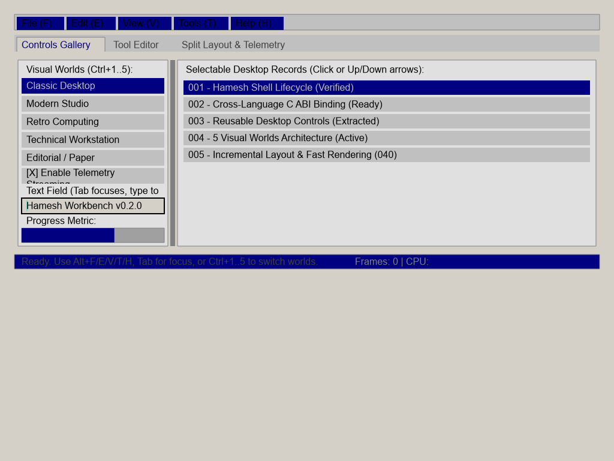
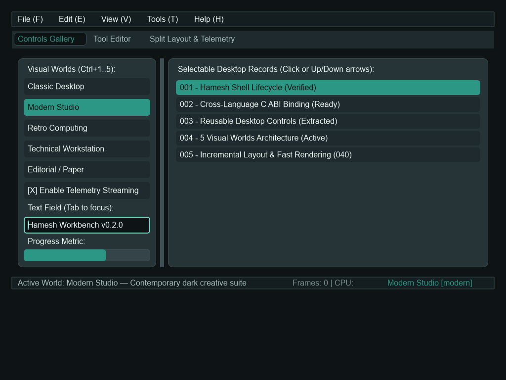
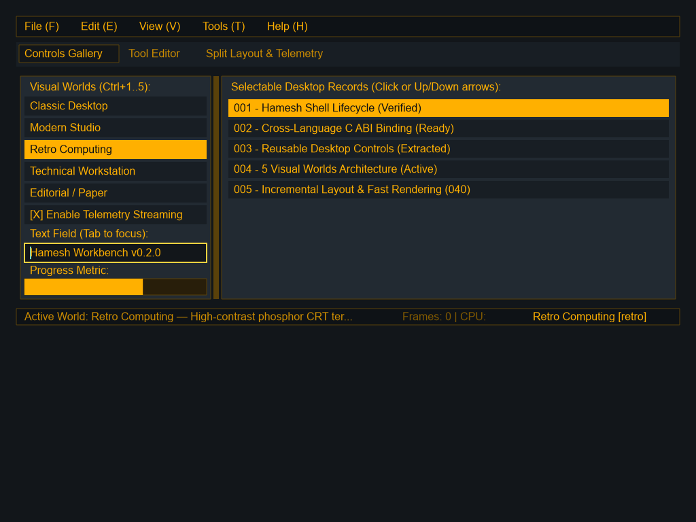
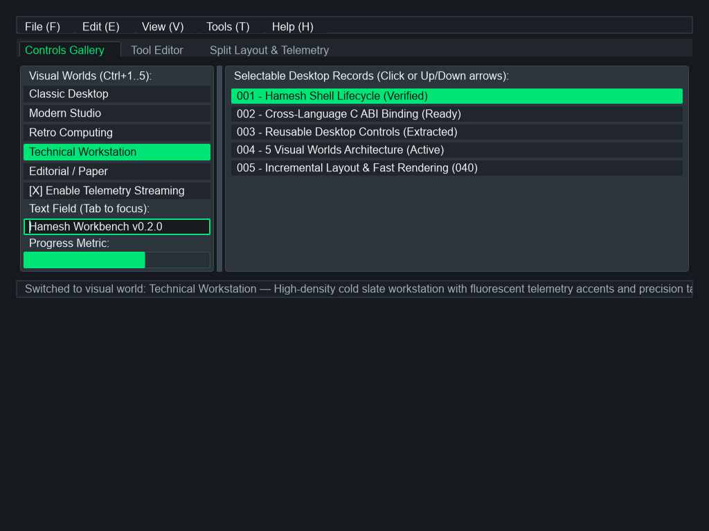
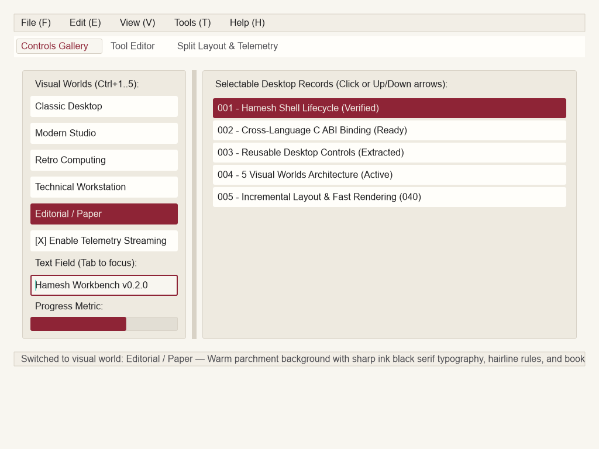

# Hamesh Visual Worlds: Desktop Design Systems Gallery

Hamesh provides **Five Visual Worlds**—distinct, complete design systems engineered for native desktop software across Rust, Python, and other languages. Rather than enforcing a single opinionated aesthetic or a generic neutral theme, Hamesh treats visual identity as a first-class architectural dimension.

Switching between visual worlds modifies typography, corner radiuses, elevation, control heights, and color tokens deterministically while **strictly preserving all application state, component trees, form inputs, and focus rings**.

---

## 1. The Five Visual Worlds

### Classic Desktop (`classic`)



- **Philosophy**: Fast, dense, utilitarian desktop design reminiscent of Windows 95/2000 and classic workstation software. Optimized for high information density and familiar spatial ergonomics.
- **Typography**: Clean system sans-serif (`Segoe UI`, `Tahoma`, `Arial`), 13px base size.
- **Corner Radius**: Sharp `2.0px` corners with crisp 1px borders and distinct 3D button bevels.
- **Density & Metrics**:
  - Control Height: `26.0px`
  - List Row Height: `24.0px`
  - Padding: `6.0px` | Gap: `4.0px`
- **Palette**: Neutral cool grays (`#D4D0C8` / `#ECE9D8`), high-contrast dark text, classic navy active selection.
- **Best-Fit Applications**: Enterprise utilities, database browsers, administrative consoles, and performance-critical operations tools.

---

### Modern Studio (`modern`)



- **Philosophy**: Contemporary, polished creative suite aesthetic with breathing room, soft corner radii, and nuanced contrast layers.
- **Typography**: Precision variable neo-grotesque (`Instrument Sans`, `Inter`), 14px base size.
- **Corner Radius**: Smooth `6.0px` (controls) to `8.0px` (cards) with subtle translucent border strokes.
- **Density & Metrics**:
  - Control Height: `34.0px`
  - List Row Height: `30.0px`
  - Padding: `8.0px` | Gap: `8.0px`
- **Palette**: Deep charcoal surfaces (`#1E1E24`, `#2B2B36`), electric violet/blue accent, crisp white text.
- **Best-Fit Applications**: Creative tools, code editors, digital audio workstations, interactive workbench apps.

---

### Retro Computing (`retro`)



- **Philosophy**: High-contrast CRT terminal aesthetic inspired by amber/green phosphors and late-70s/early-80s computing monitors.
- **Typography**: Fixed-width mono (`Cascadia Code`, `VT100`, `Courier New`), 13px base size.
- **Corner Radius**: Completely square `0.0px` corners, hard borders, bracketed controls (`[X]`, `[ ]`).
- **Density & Metrics**:
  - Control Height: `28.0px`
  - List Row Height: `26.0px`
  - Padding: `6.0px` | Gap: `4.0px`
- **Palette**: Phosphor green / warm amber on pitch black background (`#0D1117`), intense glow highlights.
- **Best-Fit Applications**: Terminal emulators, debug consoles, security monitoring, embedded system tools.

---

### Technical Workstation (`technical`)



- **Philosophy**: High-density engineering instrument inspired by oscilloscopes, logic analyzers, telemetry systems, and CAD control panels.
- **Typography**: Dense technical monospace (`JetBrains Mono`, `Consolas`), 12px base size.
- **Corner Radius**: Minimal `1.0px` to `2.0px` corners, structured grid borders, high information density.
- **Density & Metrics**:
  - Control Height: `24.0px`
  - List Row Height: `22.0px`
  - Padding: `4.0px` | Gap: `4.0px`
- **Palette**: Dark slate surfaces (`#1A202C`), cyan instrument telemetry tokens, safety yellow/amber alert indicators.
- **Best-Fit Applications**: Signal monitoring, real-time telemetry, robotics control, CAD inspectors, profiling tools.

---

### Editorial / Warm Paper (`editorial`)



- **Philosophy**: Bookish, serene, print-inspired visual environment engineered for deep reading, writing, and distraction-free authoring.
- **Typography**: Refined literary serif (`Georgia`, `Merriweather`, `Newsreader`), 15px base size.
- **Corner Radius**: Gentle `4.0px` corners with warm tactile paper surfaces.
- **Density & Metrics**:
  - Control Height: `36.0px`
  - List Row Height: `34.0px`
  - Padding: `12.0px` | Gap: `10.0px`
- **Palette**: Warm cream/sepia background (`#FBF0D9` / `#F4ECD8`), rich bookish ink text (`#2C221E`), muted crimson accents.
- **Best-Fit Applications**: Document editors, markdown authoring suites, knowledge bases, note-taking applications.

---

## 2. Architectural Comparison Matrix

| Visual World | Theme Key | Font Family | Control H | Row H | Radius | Padding | Aesthetic Intent |
|---|---|---|---|---|---|---|---|
| **Classic Desktop** | `classic` | Segoe UI, sans-serif | 26px | 24px | 2px | 6px | Dense, familiar, utilitarian |
| **Modern Studio** | `modern` | Instrument Sans, sans-serif | 34px | 30px | 6px | 8px | Sleek, contemporary, balanced |
| **Retro Computing** | `retro` | Cascadia Code, monospace | 28px | 26px | 0px | 6px | Phosphor CRT, bracketed |
| **Technical Workstation** | `technical` | JetBrains Mono, monospace | 24px | 22px | 1px | 4px | Ultra-dense telemetry grid |
| **Editorial Paper** | `editorial` | Georgia, serif | 36px | 34px | 4px | 12px | Warm sepia, literary, calm |

---

## 3. Integration & Theme Switching Contract

### Rust API

In native Rust applications, visual worlds can be referenced directly using the `VisualWorld` enum from `hamesh-theme`:

```rust
use hamesh_theme::VisualWorld;

// 1. Query metrics
let world = VisualWorld::TechnicalWorkstation;
let row_height = world.row_height(); // 22.0 px
let font = world.font_family();     // "JetBrains Mono"

// 2. Apply to application root
app.components.get_mut("root").unwrap()
    .props.insert("theme".to_string(), world.name().to_string());
app.revision += 1;
```

### Python & C ABI

Foreign language bindings switch visual worlds by setting the `"theme"` property on the root component. All child components automatically re-evaluate color tokens, border styles, and text metrics on the next frame:

```python
from hamesh import HameshInteractiveApp

app = HameshInteractiveApp(title="My Tool")
app.setup_ui()

# Switch dynamically to Editorial Paper
app.set_prop("root", "theme", "editorial")

# Switch dynamically to Retro Terminal
app.set_prop("root", "theme", "retro")
```

### State Preservation Guarantee

Hamesh guarantees that switching visual worlds:
1. **Never drops user inputs**: Text input contents, multi-line editor buffers, and undo stacks remain intact.
2. **Never resets selection**: Active list row index, tab selections, and checkbox states remain identical.
3. **Never resets keyboard focus**: The active focused element in `FocusRing` remains focused.
4. **Is deterministic**: Running identical layout computations produces identical bounding rectangles for a given world.
